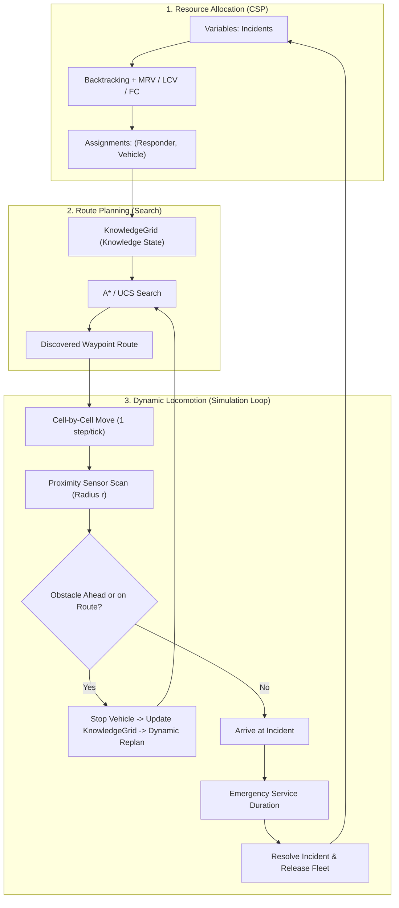

# RescueGrid: AI Search Problem Formulation

## Phase 7: Local Optimization & Hill Climbing Algorithm

This document formalizes the disaster response evacuation and route planning problem for the **RescueGrid** system as a discrete state-space search task under classical Artificial Intelligence principles (Russell & Norvig, *Artificial Intelligence: A Modern Approach*).

---

## 1. Formal Problem Formulation

The pathfinding problem for emergency dispatch in RescueGrid is formulated as a 6-tuple search problem:

$$\mathcal{P} = \langle S_0, S_G, \mathcal{S}, \mathcal{A}, \mathcal{T}, \mathcal{C} \rangle$$

### 1.1 Initial State ($S_0$)
- **Definition**: The starting discrete grid coordinate $(x_0, y_0)$ where the rescue vehicle (or emergency responder unit) is deployed.
- **Representation**: A `Position` instance encapsulating discrete Cartesian coordinates within grid boundaries.
- **Precondition**: The initial cell must be valid and walkable ($Cell(x_0, y_0).is\_walkable = \text{True}$). If the initial cell is blocked by an obstacle or hazard, dispatch cannot commence.

### 1.2 Goal State ($S_G$)
- **Definition**: The target discrete coordinate $(x_g, y_g)$ representing the reported disaster incident location or casualty extraction point.
- **Representation**: A `Position` instance corresponding to the designated emergency incident.
- **Precondition**: The goal cell must be traversable ($Cell(x_g, y_g).is\_walkable = \text{True}$). If the goal cell is completely impassable, the destination cannot be directly entered.

### 1.3 State Space ($\mathcal{S}$)
- **Definition**: The set of all valid, bounded, traversable discrete coordinates on the 2D disaster simulation grid:
  $$\mathcal{S} = \{ (x, y) \in \mathbb{Z}^2 \mid 0 \le x < \text{cols}, \; 0 \le y < \text{rows}, \; \text{Cell}(x, y).is\_walkable = \text{True} \}$$
- **Disaster Context**: The physical disaster area is represented by a bounded $M \times N$ matrix. Cells containing physical obstacles, structural rubble, deep water, or active fire zones are strictly excluded from the traversable state space $\mathcal{S}$.

### 1.4 Action Space ($\mathcal{A}$)
- **Definition**: Discrete cardinal displacements available to response units. Only orthogonal movements are permitted (diagonal movements are excluded):
  $$\mathcal{A} = \{ \text{UP}, \text{DOWN}, \text{LEFT}, \text{RIGHT} \}$$
  - $\text{UP}$: Displacement by $(0, -1)$
  - $\text{DOWN}$: Displacement by $(0, +1)$
  - $\text{LEFT}$: Displacement by $(-1, 0)$
  - $\text{RIGHT}$: Displacement by $(+1, 0)$
- **Applicable Actions**: At any state $s = (x, y) \in \mathcal{S}$, the applicable action set $\mathcal{A}(s) \subseteq \mathcal{A}$ contains those movements whose resulting coordinates lie inside grid boundaries and land on walkable cells.

### 1.5 Transition Model ($\mathcal{T}$)
- **Deterministic Transition**: Executing action $a \in \mathcal{A}(s)$ from state $s$ transitions deterministically to the adjacent target cell $s'$:
  $$\mathcal{T}(s, a) = s' = (x + \Delta x_a, \; y + \Delta y_a)$$
- Actions are strictly deterministic: transition probability $P(s' \mid s, a) = 1.0$ when $a \in \mathcal{A}(s)$.

### 1.6 Goal Test
- **Criterion**: Evaluates whether the current state $s$ is identical to the target incident location $S_G$:
  $$\text{IsGoal}(s) \iff s = S_G \iff (s.x = S_G.x \land s.y = S_G.y)$$

### 1.7 Path Cost Model ($\mathcal{C}$)

#### Cost Calculation Convention
The cost of entering a cell is its designated movement cost.
For a path $p = \langle s_0, s_1, s_2, \dots, s_k \rangle$:

$$\text{total\_cost}(p) = \sum_{i=1}^{k} \text{cost}(s_i) = \text{cost}(s_1) + \text{cost}(s_2) + \dots + \text{cost}(s_k)$$

- **The starting cell ($s_0$) is not charged**: A stationary vehicle already occupies $s_0$; movement cost is only incurred upon transition into subsequent cells.
- A path consisting solely of the start cell ($\text{len} = 1$) incurs a total cost of $0.0$.

---

## 2. Weighted Terrain Model

The system enforces a strict distinction between **traversability** (can a vehicle enter this cell?) and **movement cost** (operational penalty incurred upon entry):

| Terrain | Symbol | Traversable | Movement Cost | Operational Description |
|---|:---:|:---:|:---:|---|
| `ROAD` | `=` | Yes | **1.0** | Clear, paved arterial roadways allowing rapid emergency transit. |
| `NORMAL` | `.` | Yes | **2.0** | Standard urban surface terrain (paved sidewalks, standard streets). |
| `ROUGH` | `:` | Yes | **4.0** | Damaged, debris-strewn, or uneven terrain imposing high movement resistance. |
| `RUBBLE` | `X` | **No** | $\infty$ (unavailable) | Collapsed buildings and physical structural collapse (impassable). |
| `WATER` | `W` | **No** | $\infty$ (unavailable) | Deep urban flood water (requires specialized aquatic craft). |
| `FIRE_ZONE` | `F` | **No** | $\infty$ (unavailable) | Active thermal hazard zone (lethal to non-specialized units). |

### Traversal Cost Invariants:
1. **Traversable Only**: Only traversable terrains receive finite positive movement costs ($c > 0$).
2. **Strict Exclusion of Hazards**: Blocked terrain is never assigned an artificial large finite cost (e.g. 99999); blocked cells evaluate to $\infty$ and are strictly excluded from neighbour expansion.
3. **Strict Validation**: Movement costs must be strictly positive finite numbers ($c > 0$, non-zero, non-negative, non-NaN, non-infinite). Any attempt to set non-numeric, boolean, zero, or negative costs raises `TypeError` or `ValueError`.
4. **Centralized & Configurable**: Costs are centrally managed via `TerrainCostConfig` and can also be overridden per cell via `cell.set_movement_cost()`.

---

## 3. A* Evaluation Function and Heuristics

A* Search uses an evaluation function $f(n)$ to estimate the total cost of the cheapest route passing through node $n$:

$$f(n) = g(n) + h(n)$$

Where:
- $g(n)$: The exact cumulative movement cost incurred from start state $S_0$ to current state $n$.
- $h(n)$: The estimated remaining cost from current state $n$ to goal destination $S_G$.
- $f(n)$: The estimated total cost of a complete solution passing through $n$.

### 3.1 Cost-Scaled Manhattan Heuristic
In a 4-connected discrete 2D grid, distance between $n = (x_n, y_n)$ and $S_G = (x_g, y_g)$ is measured via $L_1$ Manhattan distance:

$$\text{Manhattan}(n, S_G) = |x_n - x_g| + |y_n - y_g|$$

Because terrains exhibit differing movement costs, the heuristic is scaled by the minimum traversable movement cost ($c_{\min}$):

$$h(n) = \text{Manhattan}(n, S_G) \times c_{\min}$$

Where $c_{\min} = \min_{t \in \text{Traversable}} \text{cost}(t) = 1.0$ (retrieved dynamically from `TerrainCostConfig`).

### 3.2 Proof of Admissibility
A heuristic $h(n)$ is **admissible** if it never overestimates the true cost $h^*(n)$ to reach the goal:

$$h(n) \le h^*(n) \quad \forall n \in \mathcal{S}$$

1. Any valid path from $n$ to $S_G$ in a 4-connected grid requires at least $\text{Manhattan}(n, S_G)$ orthogonal movements.
2. Every valid movement incurs an entering cost $c \ge c_{\min} > 0$.
3. Thus, the actual remaining cost $h^*(n)$ must satisfy:
   $$h^*(n) \ge \text{Manhattan}(n, S_G) \times c_{\min} = h(n)$$
4. At the goal destination $S_G$, $\text{Manhattan}(S_G, S_G) = 0$, hence $h(S_G) = 0.0$.
5. Therefore, $h(n)$ is strictly admissible.

### 3.3 Proof of Consistency (Monotonicity)
A heuristic $h(n)$ is **consistent** (monotonic) if for every node $n$ and every adjacent successor $n'$ generated by action $a$:

$$h(n) \le c(n, a, n') + h(n')$$

1. By the reverse triangle inequality of discrete Manhattan metric, moving from $n$ to an adjacent neighbour $n'$ changes the Manhattan distance by at most 1:
   $$|\text{Manhattan}(n, S_G) - \text{Manhattan}(n', S_G)| \le 1$$
2. Multiplying by $c_{\min}$:
   $$|h(n) - h(n')| \le 1 \times c_{\min} = c_{\min}$$
3. Since every actual edge cost $c(n, a, n') \ge c_{\min}$:
   $$h(n) - h(n') \le c_{\min} \le c(n, a, n')$$
   $$h(n) \le c(n, a, n') + h(n')$$
4. Therefore, the cost-scaled Manhattan heuristic satisfies the triangle inequality and is consistent.

### 3.4 Optimality & Closed State Reopening
- Because $h(n)$ is consistent, $f(n)$ values along any path are monotonically non-decreasing.
- **Closed Set Property**: Under a consistent heuristic, the first time any state is removed from the priority queue (expanded into the closed set), its path cost $g(n)$ is already guaranteed to be optimal ($g(n) = g^*(n)$).
- Consequently, closed states do not strictly need to be reopened.
- However, our implementation defensively supports reopening if an improved path to a closed state were ever encountered, ensuring robust behavior across arbitrary heuristic functions.

---

## 4. Algorithm Architectures

RescueGrid implements five complementary search strategies:

### 4.1 A* Search (`AStarSearch`)
- **Frontier Structure**: Min-heap priority queue implemented with Python's standard library `heapq`.
  - Queue elements: `(f_score, h_score, entry_counter, position)`
  - Primary priority: $f(n) = g(n) + h(n)$
  - Secondary tie-breaker: $h(n)$ (preferring states closer to goal when $f$ matches)
  - Tertiary tie-breaker: `entry_counter` (ensures strict FIFO determinism)
- **Goal Test**: Performed **only when the goal is removed from the priority queue with its minimum cost**.
- **Optimality**: **Guaranteed cost-optimal**. Yields the exact same minimum cost as UCS:
  $$\text{astar\_result.total\_cost} == \text{ucs\_result.total\_cost}$$
- **Time Complexity**: $\mathcal{O}(E \log V)$ in worst case, but typically explores significantly fewer states than UCS due to directional pruning.
- **Space Complexity**: $\mathcal{O}(V) = \mathcal{O}(M \cdot N)$ to store the frontier heap, g-score dictionary, and closed set.

### 4.2 Uniform-Cost Search (`UCS`)
- **Frontier Structure**: Min-heap priority queue (`heapq`) ordered strictly by cumulative cost $g(n)$ (equivalent to A* with $h(n) = 0$).
- **Optimality**: **Guaranteed cost-optimal**. Expands uniformly in concentric cost contours.

### 4.3 Breadth-First Search (`BFS`) [Baseline]
- **Frontier Structure**: FIFO queue (`collections.deque`).
- **Optimality**: Optimal strictly with respect to **step count** (unweighted movements), but blind to terrain costs.

### 4.4 Depth-First Search (`DFS`) [Baseline]
- **Frontier Structure**: LIFO stack (`list`).
- **Optimality**: **Non-optimal**. Verifies path existence and explores deep branches.

### 4.5 Hill Climbing (`HillClimbingSearch`) [Local Search]
- **Frontier Structure**: **None** (O(1) auxiliary search memory, excluding the storage required for the returned path and exploration metrics). Maintains solely the current state and steps greedily to the single best neighbour.
- **Decision Rule**: Steepest-Ascent minimizing Manhattan distance $h(n) = |x_n - x_g| + |y_n - y_g|$. Requires strict improvement ($h(n') < h(n)$).
- **Tie-Breaking**: Lowest entering movement cost, then cardinal neighbour generation order.
- **Optimality & Completeness**: **Incomplete and non-optimal**. Easily trapped in local optima (walls, concave barriers) where moving toward the destination is obstructed.

---

## 5. Comprehensive Algorithm Comparison

| Feature | Breadth-First Search (BFS) | Depth-First Search (DFS) | Uniform-Cost Search (UCS) | A* Search | Hill Climbing (Phase 7) |
|---|:---:|:---:|:---:|:---:|:---:|
| **Paradigm** | Systematic Global | Systematic Global | Systematic Global | Systematic Global | **Greedy Local Search** |
| **Frontier Structure** | FIFO Queue (`deque`) | LIFO Stack (`list`) | Min-Heap (`heapq`) | Min-Heap (`heapq`) | **None** ($\mathcal{O}(1)$ current state) |
| **Expansion Metric** | Step depth $d(n)$ | Branch depth | Cumulative cost $g(n)$ | $f(n) = g(n) + h(n)$ | Heuristic distance $h(n)$ |
| **Heuristic Guidance** | None ($h=0$) | None ($h=0$) | None ($h=0$) | Cost-scaled Manhattan | **Pure Manhattan** $h(n)$ |
| **Optimality** | Optimal for step count | Non-optimal | **Optimal for total cost** | **Optimal for total cost** | **Non-optimal** (greedy steps) |
| **Cost Equivalence** | Diverges on weighted maps | Diverges | **Ground Truth Cost** | **Identical to UCS Cost** | Diverges (ignores cost trade-offs) |
| **Search Direction** | Concentric step rings | Deep branch dive | Concentric cost contours | **Focused toward goal** | **Steepest descent toward goal** |
| **Completeness** | Complete | Complete (with cycle check) | Complete ($c \ge \epsilon > 0$) | Complete ($c \ge \epsilon > 0$) | **Incomplete** (trapped by local optima) |
| **Backtracking** | Exhaustive search | Exhaustive search | Exhaustive search | Exhaustive search | **None** (terminates on local optimum) |
| **Memory Footprint** | $\mathcal{O}(b^d)$ | $\mathcal{O}(b \cdot m)$ | $\mathcal{O}(b^{C^*/\epsilon})$ | $\mathcal{O}(b^{C^*/\epsilon})$ | **O(1) auxiliary search memory, excluding the storage required for the returned path and exploration metrics** |
| **Goal Test Timing** | Upon queue insertion | Upon stack insertion | **Upon dequeue from heap** | **Upon dequeue from heap** | **At each greedy step** |

---

## 6. SearchResult Metric Standardization

All five algorithms return a standardized `SearchResult` model:

| Metric | Type | Successful Search | Unsuccessful Search |
|---|---|---|---|
| `algorithm_name` | `str` | Name of algorithm | Name of algorithm |
| `start_position` | `Position` | Starting coordinate $S_0$ | Starting coordinate $S_0$ |
| `goal_position` | `Position` | Destination coordinate $S_G$ | Destination coordinate $S_G$ |
| `found` | `bool` | `True` | `False` |
| `path` | `List[Position]` | $\langle s_0, s_1, \dots, s_k \rangle$ | `[]` (empty list) |
| `path_length` | `int` | $\text{len}(\text{path}) - 1$ | `0` |
| `total_cost` | `float/int/None` | Cumulative cost $\sum_{i=1}^{k} \text{cost}(s_i)$ | **`None`** |
| `nodes_explored` | `int` | Count of expanded nodes | Count of explored nodes |
| `execution_time_ms`| `float` | Wall-clock time (`time.perf_counter`) | Wall-clock time (`time.perf_counter`) |

---

## 7. Partial Observability, Mystery States & Dynamic Replanning (Phase 6)

In classical search, an agent assumes **complete observability** (omniscience), knowing all environmental states and costs prior to path calculation. In real-world urban disasters, telecommunications collapse, roads crumble, and flooding spreads dynamically, rendering complete pre-planning unviable. Phase 6 formalizes a **Partially Observable Navigation Simulation** within RescueGrid. Rather than maintaining a probabilistic belief-state distribution over unobserved variables, the planner operates directly on a deterministic `KnowledgeGrid`, discovering terrain characteristics through onboard proximity sensors and dynamically replanning when newly discovered hazards obstruct the route.

### 7.1 The Dual-Grid Architecture

To enforce absolute separation between physical ground truth and agent knowledge, the system maintains two distinct grid models:

```
                      +-----------------------------+
                      |         ActualGrid          |
                      |  (Physical Ground Truth)    |
                      +--------------+--------------+
                                     |
                          [Proximity Sensor Scan]
                           Manhattan Radius <= r
                                     |
                                     v
                      +-----------------------------+
                      |        KnowledgeGrid        |
                      |    (Agent Knowledge State)  |
                      +--------------+--------------+
                                     |
                           [Route Planning Query]
                                     |
                                     v
                      +-----------------------------+
                      |   A* / UCS / BFS Planner    |
                      | (Operates ONLY on Knowledge)|
                      +-----------------------------+
```

1. **`ActualGrid` (Ground Truth)**:
   - Represents the complete, objective physical disaster environment.
   - Contains all physical terrain categories, dynamic flood waters, structural rubble, and movement costs.
   - **Access Restriction**: Route planning algorithms must **NEVER** directly query `ActualGrid`. It is queried exclusively by the simulation environment to simulate sensor perception and validate physical movement.
2. **`KnowledgeGrid` (Agent Knowledge State)**:
   - Represents what the rescue vehicle currently knows about the disaster environment.
   - Initialized with **mystery states** (`TerrainType.UNKNOWN`), rendered as `'?'`.
   - As the vehicle traverses the environment, onboard proximity sensors discover surrounding cells, updating terrain, traversability, and movement costs deterministically without maintaining a probabilistic belief distribution.
   - Route planning algorithms (A*, UCS, BFS, DFS) execute **strictly upon the `KnowledgeGrid`**.

### 7.2 Mystery States (`TerrainType.UNKNOWN`)
- **Symbol**: `'?'` in ASCII visual grid renderings.
- **Walkability**: `is_walkable = False` (unknown cells cannot be assumed safe; planners cannot treat them as traversable until confirmed).
- **Movement Cost**: `cost = float('inf')` (no arbitrary finite cost is assigned to unconfirmed space).
- **Persistence**: Once revealed by sensor discovery, the cell's true terrain persists unless explicitly mutated by a dynamic environmental event.

### 7.3 Proximity Sensor Mechanism
The vehicle perceives its local surroundings via an onboard sensor parameterized by detection radius $r \ge 0$:

$$\text{Detectable}(s_{\text{vehicle}}, r) = \{ s \in \mathcal{S}_{\text{actual}} \mid \text{Manhattan}(s_{\text{vehicle}}, s) \le r \}$$

- **Radius 0**: Reveals only the current vehicle position.
- **Radius 1**: Reveals current position and adjacent orthogonal cells ($d \le 1$).
- **Radius 2 (Default)**: Reveals all cells with Manhattan distance $\le 2$ (up to 13 cells in open grid).
- **Boundary Enforced**: Sensors respect grid boundaries and never reveal out-of-bounds coordinates.

### 7.4 Dynamic Replanning Workflow

Dynamic replanning executes in discrete 1-cell locomotion steps:

1. **Initialization**:
   - `ActualGrid` loaded with physical disaster reality.
   - `KnowledgeGrid` initialized with mystery states (`'?'`).
   - Vehicle deployed at start position $S_0$.
2. **Initial Perception & Route Generation**:
   - Sensor scans radius $r$ around $S_0$, updating initial surroundings in `KnowledgeGrid`.
   - A* generates initial route $p = \langle S_0, s_1, s_2, \dots, S_G \rangle$ on `KnowledgeGrid`.
3. **Step-by-Step Movement Loop**:
   - **Physical Safety Invariant**: Vehicle verifies that next waypoint $s_{i+1}$ in `ActualGrid` is traversable before moving. If an unexpected obstacle blocks $s_{i+1}$, vehicle stops, updates `KnowledgeGrid`, and triggers replanning.
   - **Locomotion**: Vehicle advances 1 cell to $s_{i+1}$. Actual movement cost is accumulated on `ActualGrid`.
   - **Sensory Discovery**: Sensor scans radius $r$ around new position $s_{i+1}$, revealing newly discovered cells into `KnowledgeGrid`.
   - **Route Validity Verification**: Checks whether any cell along the remaining planned route $\langle s_{i+1}, \dots, S_G \rangle$ has become known as blocked (`is_walkable == False`).
   - **Dynamic Replanning**: If the remaining route is invalidated by newly discovered hazards, vehicle halts at $s_{i+1}$ and runs A* from $s_{i+1}$ to $S_G$ on the updated `KnowledgeGrid`.
   - **Termination**: Repeats until destination $S_G$ is reached or no feasible route exists.

### 7.5 Comparison: Static Search vs. Incomplete Knowledge vs. Online Replanning

| Dimension | Static Classical Search (Phases 3–5) | Search with Incomplete Knowledge | Online Dynamic Replanning (Phase 6) |
|---|---|---|---|
| **Environment Observability** | Fully Observable (100% known upfront) | Partially Observable (static snapshot) | **Partially Observable & Discovered Dynamically** |
| **Grid State** | Single static grid | Single knowledge grid with mystery cells | **Dual Grid: `ActualGrid` + `KnowledgeGrid`** |
| **Planning Paradigm** | One-shot offline search | One-shot search on known subset | **Interleaved Execution & Online Replanning** |
| **Handling of Hidden Hazards** | Impossible (hazards must be known upfront) | Fails if unmapped hazard blocks route | **Discovers hazard via sensor, stops, and replans** |
| **Locomotion Model** | Complete path calculated and traversed | Complete path or failure | **1-cell step-by-step physical locomotion** |
| **Cost Accounting** | Planned cost equals execution cost | Planned cost on known cells only | **Actual cost incurred physically on `ActualGrid`** |

### 7.6 Known Limitations
1. **Stationary Hazards**: Current dynamic hazards represent static environmental damage (e.g. collapsed buildings, flooded streets); active fire spread or expanding floods are not yet simulated in real time.
2. **Single-Agent Model**: The replanning engine currently models a single active response vehicle. Multi-agent collision avoidance and coordinated fleet dispatch will be addressed in future phases.

---

## 8. Local Optimization & Hill Climbing Algorithm (Phase 7)

### 8.1 The Local Search Paradigm
Classical systematic search algorithms (BFS, DFS, UCS, A*) maintain a global search frontier, systematically exploring paths through a graph or tree until a goal is discovered. In contrast, **Local Search** operates on a fundamentally different principle:
- **Zero Global Frontier**: It maintains only the current state $s \in \mathcal{S}$ rather than exploring branching candidate paths.
- **Auxiliary Search Memory**: Requires O(1) auxiliary search memory, excluding the storage required for the returned path and exploration metrics, as the algorithm does not retain an exponential search tree or priority queue in memory.
- **Greedy Local Decisions**: At each discrete time step, the agent evaluates immediate walkable neighbours and steps to the neighbour with the highest perceived promise according to a heuristic evaluation function.

### 8.2 Steepest-Ascent Hill Climbing Formulation
RescueGrid implements a deterministic **Steepest-Ascent Hill Climbing** variant that minimizes heuristic distance to the goal.

Let $s$ be the current position of the vehicle and $S_G$ be the destination.
1. **Neighbour Generation**:
   $$\text{Neighbours}(s) = \{ s' \in \mathcal{S} \mid s' = \mathcal{T}(s, a), \; a \in \mathcal{A}(s), \; \text{Cell}(s').is\_walkable = \text{True} \}$$
2. **Heuristic Evaluation**:
   Each valid walkable neighbour is evaluated using L1 Manhattan distance:
   $$h(s') = |s'.x - S_G.x| + |s'.y - S_G.y|$$
3. **Deterministic Tie-Breaking**:
   If multiple neighbours share the lowest heuristic value:
   - Primary: Lowest $h(s')$.
   - Secondary: Lowest movement cost $\text{cost}(s')$.
   - Tertiary: Cardinal generation order ($\text{UP} \to \text{DOWN} \to \text{LEFT} \to \text{RIGHT}$).
4. **Strict Improvement Condition**:
   Let $s^* = \arg\min_{s' \in \text{Neighbours}(s)} h(s')$.
   The vehicle advances to $s^*$ **if and only if**:
   $$h(s^*) < h(s)$$
   If $h(s^*) \ge h(s)$, the algorithm terminates immediately at a local optimum or plateau.
   Because the heuristic must strictly decrease at every successful move ($h(s') < h(s)$), revisiting an earlier position is mathematically impossible, eliminating the need for an auxiliary visited set and ensuring O(1) auxiliary search memory, excluding the storage required for the returned path and exploration metrics.

### 8.3 Algorithmic Limitations & Local Optima
Hill Climbing is **incomplete** and **sub-optimal**:
1. **Local Optima (Foothills)**: When an obstacle (e.g. an east-west barrier wall or concave building collapse) blocks the straight-line path to the goal, circumnavigating the barrier requires temporarily stepping away from the goal (increasing Manhattan distance). Because Hill Climbing strictly enforces $h(s^*) < h(s)$, it refuses non-improving steps and gets trapped.
2. **Plateaus and Shoulders**: When neighbouring states have identical heuristic values ($h(s') = h(s)$), strict Hill Climbing cannot determine which direction leads toward the goal and halts.
3. **No Backtracking**: Unlike A* or DFS, Hill Climbing does not maintain alternative branches to explore when a local dead end is encountered.

### 8.4 Educational Comparison: Hill Climbing vs. A*
In disaster-response pathfinding:
- **A\* Search** is a **global pathfinding algorithm**. When confronted with an obstacle wall, A* expands states around the obstacle, keeping candidate routes in its min-heap priority queue, and successfully finds the optimal bypass route.
- **Hill Climbing** is a **greedy local controller**. On open terrain with direct corridors, it executes extremely quickly ($\mathcal{O}(d)$ steps with O(1) auxiliary search memory, excluding the storage required for the returned path and exploration metrics). However, in realistic obstacle-dense disaster topologies, it frequently halts in local optima without reaching the casualty.

---

## 9. Multi-Agent Resource Allocation using Constraint Satisfaction Problems (Phase 8)

### 9.1 Introduction to Constraint Satisfaction Problems (CSP)
In classical search problems (BFS, DFS, UCS, A*, Hill Climbing), an agent searches through a state space to discover a sequence of actions leading from an initial state to a goal state. In contrast, a **Constraint Satisfaction Problem (CSP)** is an AI reasoning paradigm where the goal is to discover a complete state that satisfies a set of constraints across a collection of variables.

A CSP is formally defined as a 3-tuple:
$$\text{CSP} = (X, D, C)$$
Where:
- $X = \{X_1, X_2, \dots, X_n\}$ is a set of **variables**.
- $D = \{D_1, D_2, \dots, D_n\}$ is a set of **domains**, where $D_i$ denotes the set of allowable values for variable $X_i$.
- $C = \{C_1, C_2, \dots, C_m\}$ is a set of **constraints**, where each constraint $C_j$ specifies a subset of variables and the permissible combinations of values they may simultaneously assume.

### 9.2 RescueGrid CSP Formulation

#### 1. Variables ($X$)
In RescueGrid, each active emergency incident requiring resource dispatch represents an independent variable:
$$X = \{ I_1, I_2, \dots, I_n \}$$
Only eligible incidents (in `REPORTED` status and without existing assigned resources) are included. Resolved or already-serviced incidents are excluded.

#### 2. Domains ($D$)
For each incident $I_i \in X$, its domain $D(I_i)$ consists of feasible resource pairs:
$$d_{ij} = (r, v) \in \mathcal{R} \times \mathcal{V}$$
Where:
- $r \in \mathcal{R}$ is an available `Responder` ($r.\text{is\_available}() = \text{True}$).
- $v \in \mathcal{V}$ is an available `RescueVehicle` ($v.\text{is\_available}() = \text{True}$).
- $r.\text{specialization} \in \text{CompatibleSpecializations}(I_i)$.
- $v.\text{type} \in \text{CompatibleVehicleTypes}(I_i)$.

Only resource combinations satisfying initial availability and type compatibility enter an incident's candidate domain:
$$\begin{aligned}
\text{CompatibleSpecializations}(\text{Fire}) &= \{ \text{Firefighter} \} \\
\text{CompatibleSpecializations}(\text{StructuralCollapse}) &= \{ \text{RescueSpecialist} \} \\
\text{CompatibleSpecializations}(\text{Medical}) &= \{ \text{Paramedic} \} \\
\text{CompatibleSpecializations}(\text{Flood}) &= \{ \text{RescueSpecialist}, \text{Firefighter} \}
\end{aligned}$$

$$\begin{aligned}
\text{CompatibleVehicleTypes}(\text{Fire}) &= \{ \text{FireEngine} \} \\
\text{CompatibleVehicleTypes}(\text{StructuralCollapse}) &= \{ \text{RescueVan} \} \\
\text{CompatibleVehicleTypes}(\text{Medical}) &= \{ \text{Ambulance} \} \\
\text{CompatibleVehicleTypes}(\text{Flood}) &= \{ \text{RescueVan}, \text{FireEngine} \}
\end{aligned}$$

#### 3. Constraints ($C$)
The solver strictly enforces the following hard constraints:
1. **Responder Availability**: A responder $r$ cannot be assigned if $r.\text{is\_available}() = \text{False}$.
2. **Vehicle Availability**: A vehicle $v$ cannot be assigned if $v.\text{is\_available}() = \text{False}$.
3. **Responder Specialization**: $r.\text{specialization} \in \text{CompatibleSpecializations}(I_i)$.
4. **Vehicle Compatibility**: $v.\text{type} \in \text{CompatibleVehicleTypes}(I_i)$.
5. **Resource Uniqueness (All-Different)**: No responder or rescue vehicle can be assigned to two simultaneous incidents:
   $$\forall I_a, I_b \in X \; (a \ne b): \quad r_a \ne r_b \quad \land \quad v_a \ne v_b$$
6. **Incident Eligibility**: Resolved incidents (`status == RESOLVED`) or active incidents with existing assigned resources must never receive new allocations.
7. **Atomic Assignment**: An allocation must assign both a compatible responder and vehicle simultaneously. If a complete allocation cannot be constructed, zero partial side-effects occur.

---

### 9.3 CSP Search Engine & Heuristics

#### 1. Recursive Backtracking Search
The solver implements depth-first backtracking search:
1. If all variables $X$ are assigned, return success (the assignment is complete and consistent).
2. Select an unassigned variable $I \in X$ using **MRV** and the **Degree Heuristic**.
3. Order the domain values of $I$ using **LCV**.
4. For each candidate $(r, v) \in D(I)$:
   - Check consistency with the current partial assignment.
   - Apply **Forward Checking**: prune $(r, v)$ from all remaining unassigned variables. If any unassigned variable experiences a domain wipeout ($|D'(u)| = 0$), prune this branch immediately.
   - Provisionally assign $I \leftarrow (r, v)$ and recurse.
   - If recursion returns success, propagate success upward.
   - Otherwise, unassign $I$ (backtrack) and try the next candidate.
5. If all candidates fail, return failure.

#### 2. Minimum Remaining Values (MRV)
The MRV heuristic (also known as the *fail-first* heuristic) selects the unassigned variable with the fewest remaining valid domain values:
$$I^* = \arg\min_{I \in U} |D(I)|$$
**Rationale**: By tackling the most constrained variable first, the solver either finds an assignment quickly or fails immediately, pruning large subtrees high in the search space.

#### 3. Degree Heuristic
When multiple unassigned variables share the same minimum domain size under MRV, ties are broken using the **Degree Heuristic**. In RescueGrid, the degree of variable $I_a$ is defined as the number of other unassigned variables $I_b$ with which $I_a$ shares at least one potential resource contention:
$$\text{Degree}(I_a) = \sum_{I_b \in U \setminus \{I_a\}} \mathbb{I}\left( (\text{Responders}(I_a) \cap \text{Responders}(I_b) \ne \emptyset) \lor (\text{Vehicles}(I_a) \cap \text{Vehicles}(I_b) \ne \emptyset) \right)$$
**Rationale**: Variables that place constraints on the largest number of competing unassigned incidents are prioritized to constrain the remaining search space as early as possible.

#### 4. Least Constraining Value (LCV)
Given a selected variable $I$, LCV orders candidate pairs $(r, v) \in D(I)$ so that the candidate that rules out the *fewest* options for remaining unassigned variables is tried first:
$$\text{Cost}((r, v)) = \sum_{u \in U \setminus \{I\}} \left| \{ (r', v') \in D(u) \mid r'.id == r.id \lor v'.id == v.id \} \right|$$
Candidates are sorted in ascending order of $\text{Cost}((r, v))$. Ties are broken by lowest cumulative Manhattan distance to the incident location, followed by deterministic identifier sorting.
**Rationale**: In contrast to the fail-first principle of variable selection, value ordering follows a *succeed-first* principle, leaving maximum flexibility for subsequent assignments.

#### 5. Forward Checking
Whenever a candidate $(r, v)$ is provisionally assigned to variable $I$, forward checking inspects every remaining unassigned variable $u \in U \setminus \{I\}$ and removes any pair containing responder $r$ or vehicle $v$. If any variable $u$ is left with an empty domain ($|D'(u)| = 0$), forward checking immediately aborts the branch without recursing deeper.

---

### 9.4 Illustrative Allocation Example: Why Greedy Allocation Fails

Consider four simultaneous emergency incidents and a fleet of four responders and four vehicles:
- **Incidents**:
  - $I_1$ (Structural Collapse): Strictly requires `RescueSpecialist` + `RescueVan`. (Domain size = 1).
  - $I_2$ (Flood): Flexible multi-role incident. Accepts `RescueSpecialist` or `Firefighter`, and `RescueVan` or `FireEngine`. (Domain size = 9).
  - $I_3$ (Fire): Requires `Firefighter` + `FireEngine`. (Domain size = 4).
  - $I_4$ (Medical): Requires `Paramedic` + `Ambulance`. (Domain size = 1).
- **Fleet**:
  - Responders: 1 Rescue Specialist (`RES-01`), 2 Firefighters (`RES-02`, `RES-03`), 1 Paramedic (`RES-04`).
  - Vehicles: 1 Rescue Van (`VEH-01`), 2 Fire Engines (`VEH-02`, `VEH-03`), 1 Ambulance (`VEH-04`).

#### Naive Sequential Greedy Outcome:
1. Sequential allocator considers $I_2$ (Flood) first.
2. It greedily assigns `RES-01` (Rescue Specialist) + `VEH-01` (Rescue Van) to $I_2$.
3. When it reaches $I_1$ (Structural Collapse), `RES-01` and `VEH-01` are already taken. No other specialist exists in the fleet!
4. **Failure**: Naive allocation halts in a deadlock with $I_1$ unserved.

#### CSP Backtracking with MRV Outcome:
1. MRV calculates initial domain sizes: $|D(I_1)| = 1, |D(I_4)| = 1, |D(I_3)| = 4, |D(I_2)| = 9$.
2. MRV selects $I_1$ (or $I_4$) first. It assigns `RES-01` + `VEH-01` to $I_1$.
3. Forward checking immediately prunes `RES-01` and `VEH-01` from $I_2$'s domain, leaving $I_2$ with Firefighter and Fire Engine candidates.
4. $I_4$ is assigned `RES-04` + `VEH-04`.
5. $I_2$ is assigned `RES-02` + `VEH-02`.
6. $I_3$ is assigned `RES-03` + `VEH-03`.
7. **Success**: 100% complete, non-conflicting allocation found in 4 node expansions with 0 backtracks!

---

### 9.5 Why Allocation Can Be Infeasible
An allocation is mathematically infeasible under several conditions:
1. **Pigeonhole Specialist Scarcity**: If $k$ simultaneous incidents require a specialized resource class (e.g. `RescueSpecialist`), but the fleet contains strictly fewer than $k$ available units, Constraint 5 (Resource Uniqueness) cannot be satisfied.
2. **Vehicle Mismatch**: If compatible vehicle inventory is exhausted, incidents requiring that vehicle class experience domain wipeout.
3. **Exclusion of Ineligible Incidents**: Resolved incidents or incidents already deployed with active resources cannot receive new assignments.

In such cases, the CSP solver reports `status = FAILED`, returns `is_complete = False`, and leaves all domain models completely unaltered.

---

### 9.6 Known Limitations
1. **Static Snapshot Model**: The CSP solver operates on a static discrete snapshot of current incidents and fleet availability. It does not model continuous travel time schedules or multi-stop sequential routes (Vehicle Routing Problem).
2. **Single Resource-Pair Cardinality**: Each incident currently receives exactly one responder and one rescue vehicle. Multi-responder teams (e.g. 3 firefighters for a 5-alarm fire) will be modeled in future fleet coordination extensions.

---

## 10. Phase 9.1: Algorithm Integration & Comparative Performance Analysis

### 10.1 Motivation: Why Algorithms Are Compared
In urban disaster response, dispatch systems face heterogeneous operational environments:
- Open evacuation zones requiring rapid transit.
- High-density debris zones where direct lines are blocked by structural collapses, flood waters, or active fires.
- Multi-terrain transit networks where paved roads offer fast movement while rubble and rough ground impose high traversal resistance.

No single pathfinding algorithm is universally optimal across every disaster scenario. Integrating the algorithms into a unified benchmarking architecture enables empirical evaluation under identical physical conditions, providing quantitative insight into trade-offs between computational overhead, memory footprints, step efficiency, and true movement costs.

### 10.2 Problem Classification & Weighted vs Unweighted Pathfinding
The AI algorithms implemented in RescueGrid solve distinct classes of problems:

1. **Unweighted Graph Search (BFS and DFS)**:
   - Operate on uniform transition costs ($c(s, s') = 1$).
   - **BFS (Breadth-First Search)**: Systematic FIFO queue expansion. Guarantees finding the route with the minimum number of steps (step-optimal). Blind to non-uniform terrain friction.
   - **DFS (Depth-First Search)**: LIFO stack exploration. Explores deeply along single branches; useful as a memory-efficient baseline but sub-optimal and prone to wandering.

2. **Weighted Cost-Optimal Search (UCS and A*)**:
   - Operate on heterogeneous terrain movement costs ($\text{ROAD}=1.0$, $\text{NORMAL}=2.0$, $\text{ROUGH}=4.0$).
   - **UCS (Uniform-Cost Search)**: Dijkstra variant expanding nodes in order of cumulative $g(n)$ via min-heap. Cost-optimal under positive step costs, but expands uniformly in all directions without goal awareness.
   - **A* Search**: Evaluates $f(n) = g(n) + h(n)$ using an admissible and consistent cost-scaled Manhattan distance heuristic. Guaranteed to find the minimum-cost route while directing the search frontier towards the goal, dramatically reducing expanded states.

3. **Incomplete Local Search (Hill Climbing)**:
   - Operates by iteratively moving to the immediate cardinal neighbor that minimizes heuristic distance $h(n)$.
   - Employs $\mathcal{O}(1)$ auxiliary search memory (excluding the returned path).
   - **Incompleteness & Suboptimality**: Lacks backtracking. Easily trapped in local minima (e.g. concave obstacle barriers, dead ends). When obstacles block direct lines, Hill Climbing halts and fails to discover existing detours.

4. **Multi-Agent Constraint Satisfaction (CSP)**:
   - Solves discrete resource assignment (matching available emergency responders and vehicles to active incidents under capability, location, and exclusivity constraints).
   - **Strict Separation Rationale**: CSP addresses combinatorial constraint satisfaction, not 2D spatial grid pathfinding. Comparing CSP runtimes or exploration counts directly against grid search algorithms would constitute a category error.

### 10.3 Performance Metric Definitions

| Metric | Scientific Representation | Definition & Operational Meaning |
|---|---|---|
| **Algorithm** | Identifier string | Name of the evaluated pathfinding algorithm. |
| **Solution Found** | Boolean flag (`True` / `False`) | Indicates whether a valid, unobstructed route from start to destination was discovered. |
| **Execution Time** | Wall-clock time ($\text{ms}$) | High-resolution elapsed time measured via `time.perf_counter()`. Empirical runtime indicator on host hardware. |
| **Nodes Explored** | State expansion count ($N$) | Total discrete grid positions expanded/visited during search. Direct measure of search effort. |
| **Path Length** | Step count ($L$) | Number of movement transitions in the discovered path ($\text{len}(path) - 1$). Unweighted path metric. |
| **Total Cost** | Accumulated movement cost ($C$) | Cumulative entering cost of traversed cells: $\sum_{i=1}^{L} \text{cost}(s_i)$. Reflects true operational energy/time on weighted terrain. None if unweighted or failed. |

### 10.4 Standard Reproducible Benchmark Scenarios

1. **Scenario A: Open Grid (10x10)**:
   - Unobstructed uniform normal terrain (cost 2.0).
   - Evaluates basic exploration: BFS, UCS, A*, and HC all discover the 18-step optimal Manhattan route. Hill Climbing descends monotonically in 19 node expansions without local minima.
2. **Scenario B: Obstacle-Dense Grid (10x10)**:
   - Multi-hazard environment containing collapsed building rubble, flood water, and fire zones.
   - Systematic searches (BFS, UCS, A*) successfully locate the optimal 28-step detour route. Hill Climbing becomes trapped in a concave rubble basin at $x=3$ and terminates gracefully with `Solution Found = False`, cleanly demonstrating local search limitations.
3. **Scenario C: Weighted Terrain Grid (12x7)**:
   - Contrasts a short rough corridor (cost 4.0) with a longer paved highway bypass (cost 1.0).
   - Proves why UCS and A* find cheaper paths (cost 14.0, 13 steps) than BFS (cost 34.0, 9 steps), saving 58.8% in movement cost.
   - Proves heuristic pruning efficiency: A* expands only 19 nodes compared to UCS's 53 nodes (64% reduction in state evaluations).
4. **Scenario D: No-Solution Grid (8x8)**:
   - Disaster grid bisected by an impassable barrier of rubble, flood, and fire hazards.
   - All five algorithms verify failure without unhandled exceptions or crashes, returning `found = False`, `path = []`, and `total_cost = None`.

### 10.5 Scientific Disclaimer on Empirical Runtimes
Execution times reported in benchmarks are measured using high-resolution wall-clock timers (`time.perf_counter()`). However, single-run execution times depend on operating system scheduling, thread preemption, memory caching, and Python interpreter bytecode execution overhead. They must not be construed as universal proof of algorithmic superiority; asymptotic complexity ($\mathcal{O}$) and node exploration counts ($N$) remain the definitive platform-independent metrics of algorithmic efficiency.

---

## 11. Phase 9.3: Complete Disaster Response Simulation Integration

### 11.1 Problem Classification & Architectural Separation

Phase 9.3 synthesizes the individual algorithmic capabilities developed across previous phases into a unified, interactive disaster-response simulation loop. To maintain theoretical and mathematical rigor, the simulation enforces a strict three-tier problem separation:



#### 1. Pathfinding as a Classical State-Space Search Problem
- **Problem**: Finding a sequence of adjacent cell transitions connecting the rescue vehicle's current position to an incident location.
- **Formalism**: $\mathcal{P} = \langle S_0, S_G, \mathcal{S}, \mathcal{A}, \mathcal{T}, \mathcal{C} \rangle$.
- **Algorithms**: BFS, DFS, UCS, A*, and Hill Climbing. UCS and A* serve as primary planners because they guarantee cost-optimality over weighted disaster terrain.
- **Scope Boundary**: Solves *spatial routing* on a 2D grid. Blind to personnel specializations, vehicle types, or multi-incident resource scarcity.

#### 2. Resource Assignment as a Constraint Satisfaction Problem (CSP)
- **Problem**: Assigning available personnel and vehicles from a central depot to simultaneous disaster emergencies under capability and uniqueness constraints.
- **Formalism**: $CSP = \langle X, D, C \rangle$, solved via depth-first recursive backtracking with MRV, Degree Heuristic, LCV, and Forward Checking.
- **Scope Boundary**: Solves *combinatorial resource allocation*. Blind to spatial distances, terrain friction, and movement paths.
- **No-Teleportation Invariant**: Unlike pure dispatch models where assignments directly teleport units, the integrated simulator commits resource availability and bindings while preserving physical vehicle coordinates. Vehicles remain at their actual locations and must physically traverse the grid cell-by-cell.

#### 3. Dynamic Navigation as a Partially Observable Navigation Simulation
- **Problem**: Safely navigating an autonomous rescue vehicle toward an incident in an uncertain disaster environment containing hidden or evolving hazards.
- **Formalism**: Modeled as a Partially Observable Navigation Simulation:
  - **Ground Truth ($\mathcal{E}_{\text{actual}}$)**: The objective physical environment (`ActualGrid`) containing true terrain friction, collapsed rubble, flood waters, and active fires. Queried strictly for physical safety validation and sensor detection.
  - **Perceived Knowledge State ($K_t$)**: The agent's knowledge grid (`KnowledgeGrid`). Unexplored cells default to mystery states (`TerrainType.UNKNOWN`), which evaluate to impassable ($\text{cost} = \infty$). The planner operates on this deterministic representation rather than maintaining a probabilistic belief-state distribution over possible worlds.
  - **Sensory Observation ($O_t$)**: Proximity sensor scanning a Manhattan radius ($r = 2$) around the vehicle's current position to discover terrain:
    $$O_t = \{ (x, y) \in \mathcal{E}_{\text{actual}} \mid |x - x_v| + |y - y_v| \le r \}$$
  - **Knowledge State Update**: Discovered coordinates deterministically update the internal `KnowledgeGrid`:
    $$K_{t+1} = \text{Update}(K_t, O_t)$$
  - **Dynamic Replanning**: If an unexpected hazard intersects the planned trajectory, the vehicle halts, updates $K_{t+1}$, and recalculates an alternative route from current coordinates to the incident using the configured search planner.

---

### 11.2 Discrete Simulation Event Loop Mechanics

The simulation proceeds along a discrete integer clock ($t = 0, 1, 2, \dots$). At each simulation tick:
1. **Target Selection**: If unassigned incidents exist, the simulator prioritizes them by descending severity rating ($\text{severity} \in \{1, \dots, 5\}$).
2. **CSP Allocation**: The CSP solver matches available personnel and vehicles to the prioritized incidents without teleportation.
3. **Discrete Vehicle Locomotion**: For each dispatched vehicle:
   - Evaluates the immediate next waypoint $s_{t+1}$ on the planned path.
   - **Physical Safety Check**: Verifies traversability on `ActualGrid` before movement. If $s_{t+1}$ is blocked in reality:
     - The vehicle halts at $s_t$ without entering $s_{t+1}$.
     - The hazard is revealed in `KnowledgeGrid`.
     - An alternative route is dynamically planned from $s_t$.
     - If no route exists, the mission terminates as failed.
   - **Safe Transition**: If $s_{t+1}$ is traversable:
     - Vehicle advances 1 cell: $s_t \leftarrow s_{t+1}$.
     - Incurs physical entering movement cost: $C \leftarrow C + \text{cost}(s_{t+1})$.
     - Onboard sensor scans surroundings within radius $r$, updating `KnowledgeGrid`.
     - If newly revealed obstacles invalidate the remaining planned path, triggers dynamic replanning.
4. **On-Scene Service**: Upon arrival ($s_t = S_G$), the vehicle spends a configurable `service_duration` ticks administering emergency aid.
5. **Incident Resolution & Resource Release**:
   - Incident transitions to `IncidentStatus.RESOLVED`.
   - Assigned responder and vehicle are marked available (`is_available = True`).
   - Released resources immediately re-enter the eligible fleet pool for subsequent queued incidents.

---

### 11.3 Structured Event Logging Specification

Every significant state change records a structured `SimulationEvent` object:

| Event Type | Trigger Condition | Associated Entities |
|---|---|---|
| `INCIDENT_CREATED` | New incident registered into system | Incident ID, Position, Severity |
| `INCIDENT_PRIORITIZED` | Incident ranked by severity | Incident ID, Severity, Priority Rank |
| `RESOURCES_ALLOCATED` | CSP assigns responder & vehicle to incident | Incident ID, Responder ID, Vehicle ID |
| `ROUTE_CALCULATED` | Route planner computes initial path | Vehicle ID, Incident ID, Waypoints, Estimated Cost |
| `VEHICLE_MOVEMENT` | Vehicle advances 1 grid cell | Vehicle ID, New Coordinates, Step Cost |
| `HAZARD_DISCOVERED` | Sensor or lookahead detects unexpected obstacle | Obstacle Position, Terrain Type |
| `ROUTE_REPLANNED` | Planner computes alternative detour around hazard | Vehicle ID, Current Coordinates, Remaining Steps |
| `VEHICLE_ARRIVED` | Vehicle reaches incident coordinates | Vehicle ID, Incident ID, Position |
| `RESCUE_IN_PROGRESS` | On-scene service tick during operation | Incident ID, Service Step Index |
| `INCIDENT_RESOLVED` | Emergency operations complete; status -> RESOLVED | Incident ID, Final Position |
| `RESOURCES_RELEASED` | Units unbound and returned to available fleet | Responder ID, Vehicle ID |
| `MISSION_FAILED` | Path permanently blocked; no alternative route | Incident ID, Failure Reason |
